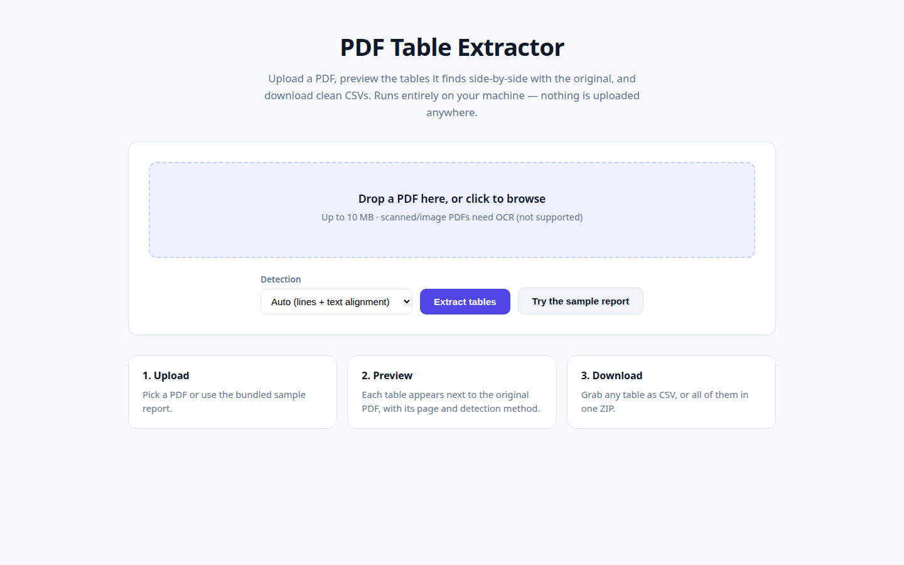
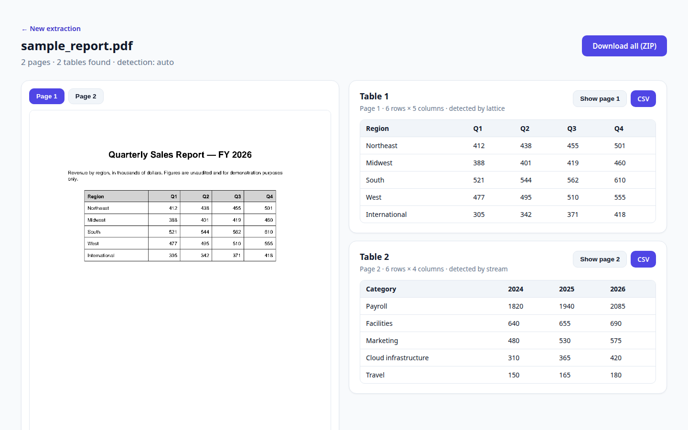

# PDF Table Extractor

Upload a PDF, preview the tables it finds **side-by-side with the original pages**, and download clean CSVs. Runs 100% locally — nothing is uploaded anywhere.




## How it works

Two detection strategies (via [pdfplumber](https://github.com/jsvine/pdfplumber)):

- **Lattice** — finds tables drawn with explicit grid lines (typical of exported reports).
- **Stream** — finds line-less tables from aligned text columns, with a post-processing pass that splits wrapped prose out of the detected region (tall text bands become split points; only groups with 3+ cleaned rows are kept) and drops stream tables that duplicate a lattice table found on the same page.

**Auto** runs both and de-duplicates. Every table is then cleaned: cells are stripped, fully-empty rows and columns are dropped.

## Run it

```bash
pip install -r requirements.txt
python app.py
```

Open http://127.0.0.1:5000, upload a PDF (or click **Try the sample report**).

The results page shows each extracted table next to a rendered image of its original page — use **Show page N** to jump between pages — with per-table CSV download and a **Download all (ZIP)** button. There is also a JSON API:

```bash
curl -F "pdf=@samples/sample_report.pdf" http://127.0.0.1:5000/api/extract
```

## Example

The bundled `samples/sample_report.pdf` (generate it with `python samples/make_sample.py`) is a two-page report:

- Page 1 — ruled quarterly sales table → detected by **lattice**: 6 rows × 5 columns
- Page 2 — line-less operating-expenses table plus surrounding prose → detected by **stream**: 6 rows × 4 columns, prose correctly excluded

```csv
Category,2024,2025,2026
Payroll,1820,1940,2085
Facilities,640,655,690
Marketing,480,530,575
Cloud infrastructure,310,365,420
Travel,150,165,180
```

## Tests

```bash
pytest tests/ -q   # 24 tests
```

## Limitations (honest ones)

- Scanned/image PDFs contain no text to extract — OCR is out of scope.
- Stream detection keeps tables with 3+ rows; tiny line-less tables may be missed.
- Tables with cells that wrap onto multiple lines can confuse the stream strategy.
- Only the first 20 pages are processed (configurable via `max_pages`).

## Stack

Python, Flask, pdfplumber. No JavaScript framework — plain CSS and a little vanilla JS.
